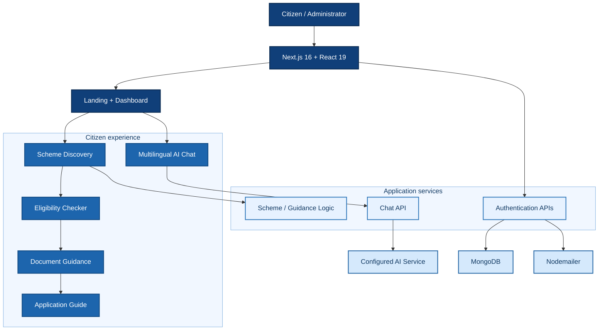
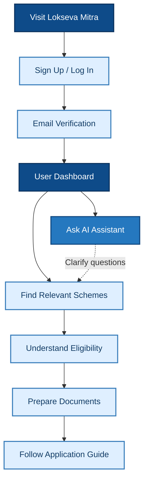
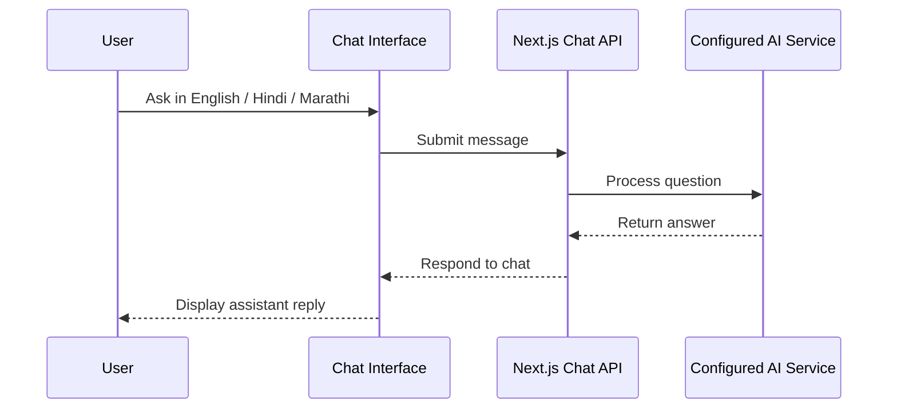

<div align="center">

<h1>LOKSEVA MITRA</h1>

<h3>AI-Assisted Government Scheme Discovery &amp; Citizen Guidance</h3>

<p><strong>Discover schemes. Understand eligibility. Prepare documents. Navigate applications.</strong></p>

<p>
  <a href="https://github.com/ImmrAD/lokseva-mitra"></a>
  
  
  
</p>

<a href="#project-overview">Overview</a> · <a href="#system-architecture">Architecture</a> · <a href="#end-to-end-user-journey">User Journey</a> · <a href="#key-features">Features</a> · <a href="#technology-stack">Tech Stack</a> · <a href="#getting-started">Setup</a> · <a href="#team-and-contact">Contact</a>

</div>

---

## Project Overview

**Lokseva Mitra (लोकसेवा मित्र)** is a full-stack platform focused on making Indian government welfare schemes easier to discover, understand, and navigate. It connects searchable scheme information with eligibility guidance, document preparation, application instructions, and a multilingual AI chat experience.

Instead of sending users through disconnected information sources, the platform presents a **connected journey from discovery to informed next steps**.

| Real-world challenge | Lokseva Mitra's approach |
|:--|:--|
| Schemes are difficult to discover. | Searchable, category-based scheme explorer. |
| Eligibility rules can be confusing. | Guided criteria-based assessment. |
| Required documents are not always clear. | Checklist with required/optional indicators and progress. |
| Application procedures take time to understand. | Guided steps, timeline, and frequently asked questions. |
| Language creates barriers. | English, Hindi, and Marathi chat experience. |

### The product thinking

The key design decision is to combine **structured workflows** with **conversational guidance**. Users can search, compare requirements, review checklists, and follow next steps without depending entirely on chat responses.

---

## System Architecture

### High-level application architecture



The architecture shows the main documented modules and integration boundaries. The actual AI provider and third-party scheme data sources depend on project configuration.

### Layer-wise responsibilities

| Layer | Core responsibility | Main technologies |
|:--|:--|:--|
| **Presentation** | Pages, forms, chat interface, responsive layouts | Next.js, React, Tailwind CSS, Framer Motion |
| **Application** | Server APIs and module logic | Next.js App Router, TypeScript |
| **Authentication** | Account creation, sign-in, verification | Authentication utilities, Nodemailer |
| **Persistence** | Account data and database connectivity | MongoDB |
| **AI and content** | Assistant interaction and supporting tools | LangChain ecosystem, Google AI packages, React Markdown, jsPDF |

---

## End-to-End User Journey

### From first visit to application readiness



### Workflow 01 — Registration and verification

```text
Create Account
    |
    v
Validate Details and Hash Password
    |
    v
Persist User in MongoDB
    |
    v
Generate Verification Token
    |
    v
Send Email via Nodemailer
    |
    v
Verify Email -> Login -> Dashboard
```

The implementation notes describe PBKDF2-SHA512 password hashing and time-limited verification tokens.

### Workflow 02 — Scheme discovery and application guidance

```text
Browse / Search Schemes
        |
        v
Filter by Category and View Details
        |
        v
Provide Eligibility Information
        |
        v
Review Criteria and Next Steps
        |
        v
Track Document Checklist
        |
        v
Follow Application Instructions
```

This is an informational support workflow; official authorities make final eligibility decisions and process applications.

### Workflow 03 — AI assistance



The documented chat module also describes conversation history and PDF export. The diagram presents the high-level interaction without assuming an undocumented retrieval technique.

---

## Key Features

| Module | What users can do |
|:--|:--|
| **Multilingual AI Chat** | Ask questions in English, Hindi, or Marathi; review conversations and export as PDF. |
| **Scheme Explorer** | Search, filter, and inspect government schemes. |
| **Eligibility Checker** | Enter profile details and review eligibility criteria. |
| **Document Guidance** | Identify required documents and follow a progress checklist. |
| **Application Guide** | Navigate a step-by-step timeline and FAQs. |
| **Account System** | Register, verify email, log in, and access a dashboard. |
| **Admin Dashboard** | View scheme, user, and application management screens. |
| **Responsive Design** | Use the interface across mobile, tablet, and desktop. |

<details>
<summary><strong>Explore account and authentication capabilities</strong></summary>

The project documentation describes registration, credential validation, password hashing, MongoDB user records, verification emails, and dashboard access. Google OAuth is described as ready for configuration.

</details>

<details>
<summary><strong>Explore scheme discovery and user guidance</strong></summary>

The scheme module offers category-based browsing, filters, and details. The eligibility module evaluates provided inputs against displayed criteria, while the document and application-guide modules convert the findings into practical preparation tasks.

</details>

<details>
<summary><strong>Explore AI chat and PDF capabilities</strong></summary>

The chat experience is designed for English, Hindi, and Marathi interaction. The implementation notes describe conversation archives and PDF export. Installed AI-related packages include LangChain, LangGraph, Google GenAI, and Google Vertex AI libraries.

</details>

---

## Technology Stack

<div align="center">
  
  
  
  
  
  
</div>

| Category | Tools and libraries |
|:--|:--|
| Frontend | Next.js 16.2.1, React 19.2.4, TypeScript |
| UI / Styling | Tailwind CSS 4, Framer Motion |
| Backend | Next.js API handlers |
| Database | MongoDB |
| Identity / Email | Authentication utilities, Nodemailer; NextAuth dependency |
| AI ecosystem | LangChain Core, Community, LangGraph, Google GenAI, Google Vertex AI packages |
| Other libraries | Supabase JS, jsPDF, React Markdown, Remark GFM, Cheerio, Puppeteer |
| Tooling | npm, ESLint, TypeScript |

**Design system:** A newspaper-inspired interface with serif headlines, monospace labels, bold dividers, structured grids, high-contrast colors, and responsive layouts.

---

## Project Structure

The implementation documents describe this module layout:

```text
lokseva-mitra/
|
|-- app/
|   |-- page.tsx              Landing page
|   |-- auth/                 Login and signup
|   |-- dashboard/            User dashboard
|   |-- chat/                 AI assistant
|   |-- schemes/              Scheme discovery
|   |-- eligibility/          Eligibility checker
|   |-- documents/            Document requirements
|   |-- guide/                Application guidance
|   |-- admin/                Admin dashboard
|   +-- api/                  Server endpoints
|
|-- src/lib/
|   |-- mongodb.ts            Database helpers
|   |-- nodemailer.ts         Email service
|   |-- auth.ts               Auth utilities
|   +-- types/                Shared interfaces
|
|-- package.json
|-- package-lock.json
|-- next.config.ts
|-- tsconfig.json
|-- QUICK_START.md
|-- IMPLEMENTATION.md
`-- README.md
```

<details>
<summary><strong>Expand the documented routes and API overview</strong></summary>

| Route | Purpose |
|:--|:--|
| `/` | Landing page |
| `/auth/signup` | Registration |
| `/auth/login` | Login |
| `/dashboard` | User dashboard |
| `/chat` | AI assistant |
| `/schemes` | Scheme discovery |
| `/eligibility` | Eligibility checker |
| `/documents` | Document guidance |
| `/guide` | Application guide |
| `/admin` | Admin interface |

| Method | Endpoint | Purpose |
|:--|:--|:--|
| `POST` | `/api/auth/register` | Register an account |
| `POST` | `/api/auth/login` | Login |
| `GET / POST` | `/api/auth/verify` | Verify email |
| `POST` | `/api/chat` | AI chat |
| `GET` | `/api/news` | News ticker |

Keep this documented API list aligned with current route handlers as the project evolves.

</details>

---

## Getting Started

### Prerequisites

- Git
- Compatible Node.js LTS and npm
- MongoDB connection details
- Email credentials for verification
- API credentials for whichever external AI/data integrations are enabled

### 1. Clone

```bash
git clone https://github.com/ImmrAD/lokseva-mitra.git
cd lokseva-mitra
```

### 2. Install dependencies

```bash
npm ci
```

### 3. Configure the environment

Create `.env.local` in the project root:

```dotenv
MONGODB_URI=your_mongodb_connection_string
NODEMAILER_SERVICE=gmail
NODEMAILER_USER=your_email@example.com
NODEMAILER_PASS=your_email_app_password
NEXT_PUBLIC_APP_URL=http://localhost:3000
SALT_SECRET=replace_with_a_long_random_secret
```

The accompanying implementation guide also mentions `GOOGLE_API_KEY`, `OGD_API_KEY`, and `SUPABASE_URL`. Configure them if the enabled features require those integrations.

> [!IMPORTANT]
> Never commit `.env.local`, database credentials, email passwords, cloud keys, or other secrets.

### 4. Run locally

```bash
npm run dev
```

Visit **http://localhost:3000**.

| Command | Purpose |
|:--|:--|
| `npm run dev` | Start development server |
| `npm run lint` | Run ESLint |
| `npm run build` | Build application |
| `npm run start` | Serve a completed production build |

<details>
<summary><strong>Expand the local demo checklist</strong></summary>

- [ ] Open the landing page.
- [ ] Register and verify an account.
- [ ] Log in and explore the dashboard.
- [ ] Search and inspect schemes.
- [ ] Walk through an eligibility assessment.
- [ ] Review the document checklist and guide.
- [ ] Try multilingual chat with the required services configured.
- [ ] Check responsive behavior on a mobile screen.

</details>

---

## Engineering Considerations and Roadmap

The product spans several meaningful engineering concerns: **account security**, **reliable public information**, **AI response quality**, **responsive UX**, and **multi-stage user guidance**.

The implementation notes identify production-hardening work including protected admin authorization, session management, secure cookies, rate limiting, and HTTPS. The following are sensible next milestones:

- [ ] Validate and clearly attribute all government scheme sources.
- [ ] Add automated checks for authentication and eligibility workflows.
- [ ] Harden access control, session security, and API protections.
- [ ] Add last-updated information and official application links.
- [ ] Improve multilingual accessibility and usability testing.
- [ ] Include verified screenshots and a live demo link.

---

## Team and Contact

**Repository owner:** [ImmrAD](https://github.com/ImmrAD)

**Collaborator:** [Prathamesh Thakare](https://github.com/thakare18) · [LinkedIn](https://www.linkedin.com/in/prathameshv-thakare/)

**Contact email (Prathamesh):** [prathameshthakre9677@gmail.com](mailto:prathameshthakre9677@gmail.com)

**Project source:** [ImmrAD/lokseva-mitra](https://github.com/ImmrAD/lokseva-mitra)

For technical discussion, collaboration, and career opportunities, connect through the linked profiles. Individual contributions can be reviewed in the repository history.

---

<div align="center">

<h3>Lokseva Mitra</h3>

<p><strong>Making public welfare information easier to discover, understand, and act on.</strong></p>

</div>
