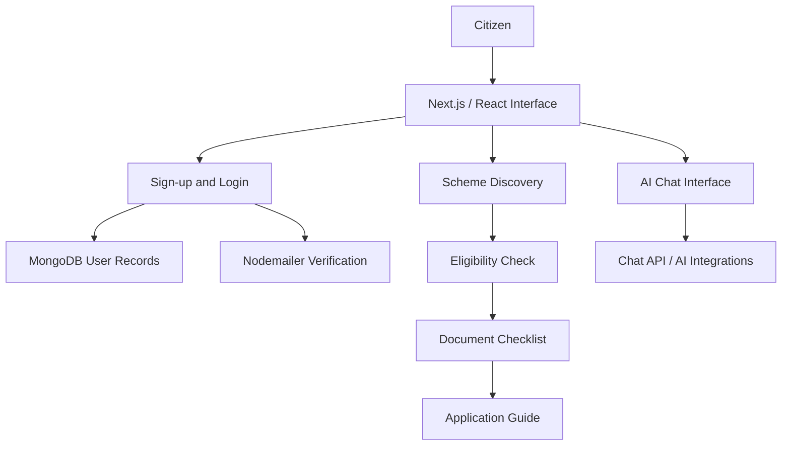

# Lokseva Mitra | लोकसेवा मित्र

### An AI-assisted gateway to government schemes and citizen services

**Discover relevant schemes. Understand eligibility. Prepare documents. Follow the application journey.**

Lokseva Mitra is a full-stack web application designed to make government welfare information easier to explore and act on. Instead of navigating disconnected sources and complex requirements, users can discover schemes, check eligibility criteria, organize required documents, and follow guided application steps in one place. An AI chat experience adds conversational assistance in English, Hindi, and Marathi.

> **Project stage:** Demonstration/development project. The features below are described in the supplied implementation documentation; the application source code and live deployment were not provided for independent verification. Eligibility guidance is informational and does not represent an official government determination.

## The problem

Finding a suitable government scheme can involve multiple portals, unfamiliar eligibility rules, document requirements, and unclear application steps. Lokseva Mitra brings these stages into a connected, approachable experience, particularly for users who benefit from local-language support.

## Core capabilities

| Module | What it helps users do |
| --- | --- |
| **Scheme discovery** | Browse, search, and filter schemes by category and inspect scheme details. |
| **Eligibility checker** | Enter relevant details and review a criteria-based eligibility assessment with next steps. |
| **Document guidance** | Work through required/optional document checklists and see preparation progress. |
| **Application guide** | Follow a step-by-step timeline with helpful tips, estimated effort, and FAQs. |
| **AI assistant** | Ask scheme-related questions through a multilingual chat interface; the documentation also describes session history and PDF export. |
| **Account management** | Sign up, verify an email address, sign in, and reach a personal dashboard. |
| **Admin dashboard** | A dedicated interface for scheme, user, and application oversight as described by the implementation notes. |
| **Responsive interface** | Use a newspaper-inspired design across desktop, tablet, and mobile layouts. |

## How Lokseva Mitra works

### Citizen journey

```text
                 ┌───────────────────────┐
                 │   Lokseva Mitra       │
                 │   Landing Page        │
                 └───────────┬───────────┘
                             │
                    Sign up / Log in
                             │
               Email verification (signup)
                             │
                 ┌───────────▼───────────┐
                 │   User Dashboard      │
                 └───────────┬───────────┘
                             │
             ┌───────────────┴────────────────┐
             │                                │
     ┌───────▼────────┐              ┌────────▼────────┐
     │ Scheme Search  │              │ Multilingual AI │
     │ & Discovery    │              │ Chat Assistant  │
     └───────┬────────┘              └─────────────────┘
             │
     ┌───────▼────────┐
     │ Eligibility    │
     │ Assessment     │
     └───────┬────────┘
             │
     ┌───────▼────────┐
     │ Document       │
     │ Checklist      │
     └───────┬────────┘
             │
     ┌───────▼────────┐
     │ Step-by-Step   │
     │ Application    │
     │ Guide          │
     └────────────────┘
```

The modules form a guidance workflow; this diagram does **not** imply that Lokseva Mitra automatically submits applications to government portals.

### At-a-glance system flow



This diagram summarizes the modules described in the project notes; individual API-to-provider calls still need source-level confirmation.

## End-to-end workflow

### 1. Account creation and verification

```text
Sign up → Validate inputs → Store user record in MongoDB
        → Send verification email → Verify token → Login → Dashboard
```

The implementation notes describe email/password registration, PBKDF2 password hashing, and time-limited verification tokens. Google sign-in is described as configuration-ready, rather than a verified live integration.

### 2. Finding a suitable scheme

```text
Dashboard → Browse / Search / Filter → Scheme Details
          → Open Eligibility Checker
```

The discovery module is intended to reduce the effort of finding potentially relevant government schemes. Actual scheme-source coverage and update frequency must be confirmed from the code and data sources.

### 3. Understanding eligibility

```text
Enter age, income, state, category and other details
        ↓
Review criteria-based assessment
        ↓
See guidance on possible next steps
```

An assessment in the app helps users understand requirements; final eligibility always depends on the official scheme authority.

### 4. Preparing an application

```text
Eligibility result → Required documents → Checklist progress
                   → Application timeline → Official next steps
```

The document and application-guide modules describe requirements and preparation steps. The supplied documentation does not establish automated government-form submission.

### 5. Asking the AI assistant

```text
User question (English / Hindi / Marathi)
        ↓
Chat interface → /api/chat
        ↓
AI integration configured by the project
        ↓
Response rendered in the chat interface
```

The documentation describes chat archives and PDF conversation export. The precise prompt design, retrieval strategy, AI model, and grounding behavior require the missing application source files for confirmation.

### Application architecture (documented / intended)

```text
Browser (React 19 + Next.js 16 UI)
              │
              ▼
Next.js App Router (TypeScript)
  ├── Pages: dashboard, chat, schemes, eligibility, documents, guide
  ├── Authentication APIs ──► MongoDB (user records)
  │                         └► Nodemailer (verification emails)
  ├── Chat API ─────────────► AI integrations (LangChain / Google AI)
  └── Scheme / information features
              └────────────► Configured data sources / APIs
```

The repository dependencies include LangChain, Google generative-AI integrations, Supabase, and other packages. **Their presence alone does not establish which provider or data source is active in every execution path.** The source code is needed to verify the exact AI pipeline and external data integrations.

## Technology stack

| Area | Technologies |
| --- | --- |
| Frontend | Next.js **16.2.1**, React **19.2.4**, TypeScript |
| Styling and motion | Tailwind CSS **4**, Framer Motion |
| Backend | Next.js server-side routes / API handlers |
| Database | MongoDB (documented for account persistence) |
| Authentication and email | Custom email/password workflow, PBKDF2 password hashing, Nodemailer verification emails; Google OAuth described as *ready for configuration* |
| AI-related dependencies | LangChain Core/Community, LangGraph, Google GenAI, Google Vertex AI |
| Other installed packages | Supabase JS, NextAuth, Cheerio, Puppeteer, jsPDF, React Markdown |
| Developer tooling | ESLint, npm, TypeScript |

> This stack separates **documented application features** from **installed dependencies**. Not every listed package is necessarily used by an active feature.

## Product design

The interface uses a distinctive editorial aesthetic rather than a conventional dashboard template:

- Deep burgundy and near-black accents on an off-white background.
- Serif headlines, monospace labels, strong borders, and grid-based layouts.
- Minimal motion, clear visual hierarchy, and mobile-responsive screens.
- Accessible, guided steps for scheme discovery and document preparation.

## Routes and modules

The following routes are listed in the supplied project documentation:

| Route | Purpose |
| --- | --- |
| `/` | Landing page |
| `/auth/signup` | Registration |
| `/auth/login` | Login |
| `/dashboard` | User dashboard |
| `/chat` | AI chat assistant |
| `/schemes` | Scheme discovery |
| `/eligibility` | Eligibility assessment |
| `/documents` | Document guidance |
| `/guide` | Application steps |
| `/admin` | Admin dashboard |

Documented API routes include `POST /api/auth/register`, `POST /api/auth/login`, `GET/POST /api/auth/verify`, `POST /api/chat`, and `GET /api/news`. Confirm their availability against the current source tree before publishing this list as an API contract.

## Project structure (from implementation notes)

```text
lokseva-mitra/
├── app/
│   ├── page.tsx               # Landing page
│   ├── auth/                  # Sign up and login
│   ├── dashboard/             # Personal dashboard
│   ├── chat/                  # AI assistant
│   ├── schemes/               # Scheme browser
│   ├── eligibility/           # Eligibility form and results
│   ├── documents/             # Document checklist
│   ├── guide/                 # Application instructions
│   ├── admin/                 # Admin interface
│   └── api/                   # Server-side endpoints
├── src/lib/                   # Auth, MongoDB, email, types
├── package.json               # Dependencies and scripts
├── next.config.ts             # Next.js configuration
└── README.md                  # Project documentation
```

The tree is based on the supplied `IMPLEMENTATION.md` and `SUMMARY.md`; the `app/` and `src/lib/` files were not included among the attachments available for this review.

## Getting started

### Prerequisites

- Git and Node.js/npm installed on your machine.
- A MongoDB connection for database-dependent features.
- Email credentials for the documented verification flow.
- Provider/API credentials for any AI or external-data features you plan to use.

### 1. Clone the repository

```bash
git clone https://github.com/ImmrAD/lokseva-mitra.git
cd lokseva-mitra
```

### 2. Install dependencies

```bash
npm install
```

### 3. Configure local environment

Create a `.env.local` file in the project root. Based on the supplied setup guide, the following variables support the documented authentication/email setup:

```dotenv
MONGODB_URI=your_mongodb_connection_string
NODEMAILER_SERVICE=gmail
NODEMAILER_USER=your_email_address
NODEMAILER_PASS=your_email_app_password
NEXT_PUBLIC_APP_URL=http://localhost:3000
SALT_SECRET=replace_with_a_long_random_secret
```

Depending on your actual chat and scheme-data integration, additional values may be needed (the implementation notes mention `SUPABASE_URL`, `GOOGLE_API_KEY`, and `OGD_API_KEY`). Check the source before deciding which are mandatory. **Never commit `.env.local`, credentials, or keys.**

### 4. Start the application

```bash
npm run dev
```

Open **http://localhost:3000**.

Other available scripts:

```bash
npm run lint
npm run build
npm run start
```

`npm run start` serves a production build and should be run after `npm run build`.

## Suggested demo walkthrough

```text
1. Open home page
2. Register → verify email → sign in
3. Browse schemes and select a relevant one
4. Enter details in the eligibility checker
5. Review the document checklist
6. Follow the application guide
7. Ask a question in English, Hindi, or Marathi chat
8. Explore the admin view (with authorized access)
```

## Engineering considerations and next steps

This project brings together user-facing experiences, backend routes, third-party integrations, and an information-guidance workflow. Before any production release, the team should verify and harden:

- Server-side session management and authorization checks for protected/admin routes.
- Authentication rate limiting, secure cookies, CSRF controls as applicable, and HTTPS.
- Scheme source attribution, freshness, eligibility accuracy, and clear official-portal links.
- AI response grounding, privacy controls, and safe handling of user-provided information.
- Automated tests, error handling, accessibility, and deployment configuration.

**Important:** The supplied notes explicitly flag session management, role-based access controls, rate limiting, and production security as follow-up work. This README does not claim those controls are complete.

## Project links

- **GitHub:** https://github.com/ImmrAD/lokseva-mitra
- **Live demo** https://lokseva-mitra.vercel.app/

---

**Lokseva Mitra** — making the path from *finding a scheme* to *understanding how to apply* more navigable, multilingual, and user-friendly.
